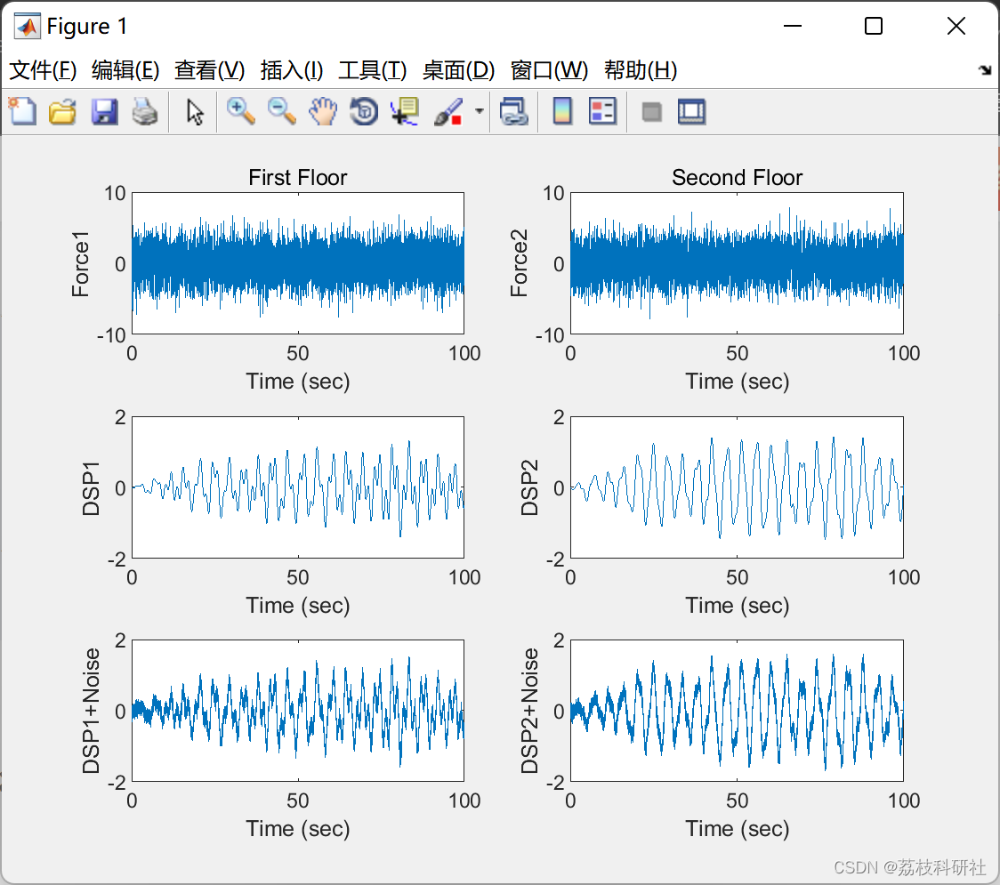
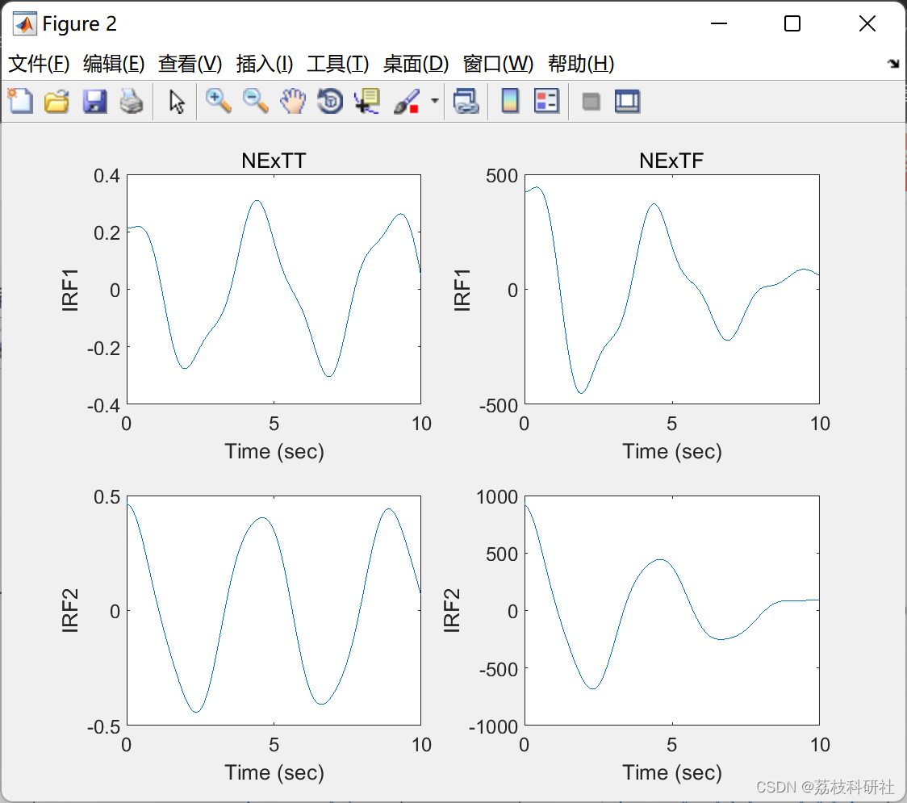
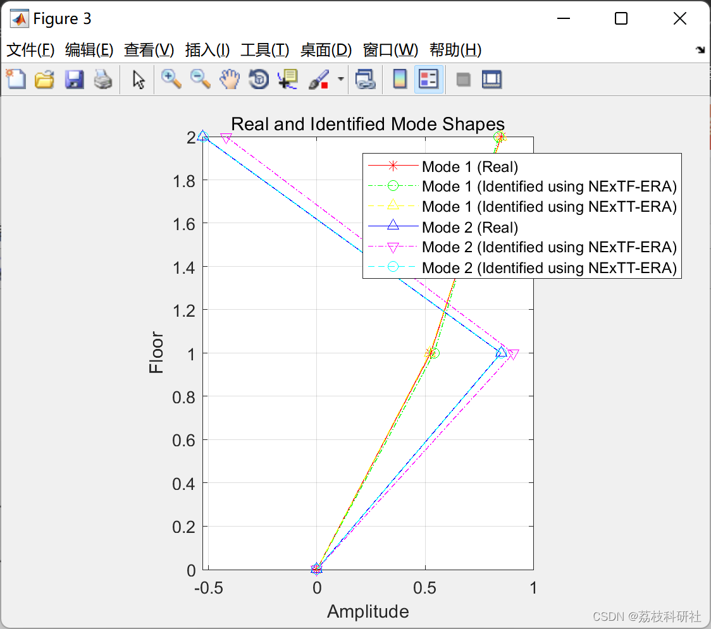
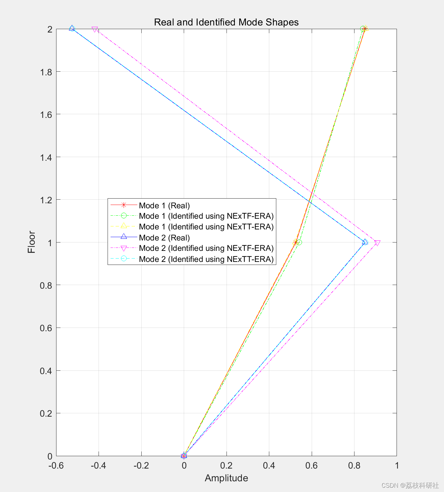

# Natural Encouragement Technology (NExT) and Feature System Implementation Algorithm (ERA) (Matlab Code Implementation)

Used to identify 2DOF systems influenced by Gaussian white noise, and increase the uncertainty of both excitation and response (also Gaussian white noise).
[Result] = NExTTERA(data, refch, maxlags, fs, ncols, nrows, cut, shift, EMAC_option) Input: data: Array containing the response data with dimensions (nch, Ndata), where nch is the number of channels. Ndata is the total length of data references: vector of vecors in reference channels. Maxlags: lag number in cross-correlation function fs: sampling frequency ncols: number of columns in Hankel matrix (exceeds 2/3*numref*(maxlags+1)) nrows: number of rows in Hankel matrix (exceeds 20 * mode number) Slicing: shift value in last row and column block (increase EMAC sensitivity) usually =10 EMAC_option: if this value equals 1, EMAC will be independent of column number (calculated only based on observability matrix, not controllability matrix) Output: Results: The structure consists of the following components: Parameters: NaFreq: Intrinsic frequency vector Damping ratio: Damping ratio vector Mode shape: modal shape matrix Index: MAmC: Coherence of modal amplitude EMAC: Extended coherence MPC: Colinearity of modal phase CMI: Consistent mode indicator Parts: Involved factors Matrix A, B, C: Discrete A, B, and C matrices [Result] = NExTFERA(data, refch, window, N, p, fs, ncols, nrows, cut, shift, EMAC_option) Input: data: Array containing response data with dimensions (nch, Ndata), where nch is the number of channels. Ndata is the total length of data. refch: reference channel's vector.its size (numref, 1) where numref is the number of reference channels.window: window size to obtain spectral density N: number of windows p: overlap ratio between windows. From 0 to 1 fs: Sampling frequency ncols: The number of columns in the Hankel matrix (greater than 2/3*number of reference*(ceil(window/2+1)-1)) nrows: The number of rows in the Hankel matrix (exceeding 20*modes) cut: Cutoff value = 2*modes shift: Last row and column block shift values (increasing EMAC sensitivity) Usually =10 EMAC_option: If this value is equal to 1, EMAC will be independent of the number of columns (calculated only based on observability matrix, not controllability matrix) Output: Results: The structure consists of the following components Parameters: NaFreq: Intrinsic frequency vector Damping ratio: Damping ratio vector Mode shape: Vibration mode matrix Indicator: MAmC: Mode amplitude coherence EMAC: Extended mode amplitude coherence MPC: Mode phase collinearity CMI: Consistent mode indicator Part: Participation factor Matrix A, B, C: Discrete A, B, and C matrices📊2 Run results
Editor
Editor
Editor
🌈3 Matlab code implementation:
%Apply modal superposition to get response  
%--------------------------------------------------------------------------  
n=size(f,1);  
dt=1/fs; %sampling rate  
[Vectors, Values]=eig(K,M);  
Freq=sqrt(diag(Values))/(2*pi); % undamped natural frequency  
steps=size(f,2);  
Mn=diag(Vectors'*M*Vectors); % uncoupled mass  
Cn=diag(Vectors'*C*Vectors); % uncoupled damping  
Kn=diag(Vectors'*K*Vectors); % uncoupled stifness  
wn=sqrt(diag(Values));  
zeta=Cn./(sqrt(2.*Mn.*Kn)); % damping ratio  
wd=wn.*sqrt(1-zeta.^2);  
fn=Vectors'*f; % generalized input force matrix  
t=[0:dt:dt*steps-dt];  
for i=1:1:n  
h(i,:)=(1/(Mn(i)*wd(i))).*exp(-zeta(i)*wn(i)*t).*sin(wd(i)*t); %transfer function of displacement  
hd(i,:)=(1/(Mn(i)*wd(i))).*(-zeta(i).*wn(i).*exp(-zeta(i)*wn(i)*t).*sin(wd(i)*t)+wd(i).*exp(-zeta(i)*wn(i)*t).*cos(wd(i)*t)); %transfer function of velocity  
hdd(i,:)=(1/(Mn(i)*wd(i))).*((zeta(i).*wn(i))^2.*exp(-zeta(i)*wn(i)*t).*sin(wd(i)*t)-zeta(i).*wn(i).*wd(i).*exp(-zeta(i)*wn(i)*t).*cos(wd(i)*t)-wd(i).*((zeta(i).*wn(i)).*exp(-zeta(i)*wn(i)*t).*cos(wd(i)*t))-wd(i)^2.*exp(-zeta(i)*wn(i)*t).*sin(wd(i)*t)); %transfer function of acceleration  
end  
x=Vectors*q; %displacement  
v=Vectors*qd; %vecloity  
a=Vectors*qdd; %vecloity  
%Add noise to excitation and response  
%--------------------------------------------------------------------------  
f2=f+0.1*randn(2,10000);  
a2=a+0.1*randn(2,10000);  
v2=v+0.1*randn(2,10000);  
x2=x+0.1*randn(2,10000);  
%Plot displacement of first floor without and with noise  
%--------------------------------------------------------------------------  
figure;  
subplot(3,2,1)  
plot(t,f(1,:)); xlabel('Time (sec)'); ylabel('Force1'); title('First Floor');  
subplot(3,2,2)  
plot(t,f(2,:)); xlabel('Time (sec)'); ylabel('Force2'); title('Second Floor');  
subplot(3,2,3)  
plot(t,x(1,:)); xlabel('Time (sec)'); ylabel('DSP1');  
subplot(3,2,4)  
plot(t,x(2,:)); xlabel('Time (sec)'); ylabel('DSP2');  
subplot(3,2,5)  
plot(t,x2(1,:)); xlabel('Time (sec)'); ylabel('DSP1+Noise');  
subplot(3,2,6)  
plot(t,x2(2,:)); xlabel('Time (sec)'); ylabel('DSP2+Noise');  
%Identify modal parameters using displacement with added uncertainty  
%--------------------------------------------------------------------------  
data=x2;  
refch=2;  
maxlags=999;  
window=2000;  
N=5;  
p=0;  
ncols=800;  
nrows=200;  
cut=4;  
shift=10;  
EMAC_option=1;  
[Result1] = NExTFERA(data,refch,window,N,p,fs,ncols,nrows,cut,shift,EMAC_option);  
[Result2] = NExTTERA(data,refch,maxlags,fs,ncols,nrows,cut,shift,EMAC_option);  
%Plot Impulse Response Functions  
%--------------------------------------------------------------------------  
IRFT= NExTT(data,refch,maxlags);  
IRFF= NExTF(data,refch,window,N,p);  
t2=[0:dt:999*dt];  
figure;  
subplot(2,2,1)  
plot(t2,IRFT(1,:)); xlabel('Time (sec)'); ylabel('IRF1'); title('NExTT');  
subplot(2,2,2)  
plot(t2,IRFF(1,:)); xlabel('Time (sec)'); ylabel('IRF1'); title('NExTF');  
subplot(2,2,3)  
plot(t2,IRFT(2,:)); xlabel('Time (sec)'); ylabel('IRF2');  
subplot(2,2,4)  
plot(t2,IRFF(2,:)); xlabel('Time (sec)'); ylabel('IRF2');  
%Plot real and identified first modes to compare between them  
%--------------------------------------------------------------------------  
figure;  
plot([0 ; -Vectors(:,1)],[0 1 2],'r*-');  
hold on  
plot([0 ;Result1.Parameters.ModeShape(:,1)],[0 1 2],'go-.');  
hold on  
plot([0 ;Result2.Parameters.ModeShape(:,1)],[0 1 2],'y^--');  
hold on  
plot([0 ; -Vectors(:,2)],[0 1 2],'b^-');  
hold on  
plot([0 ;Result1.Parameters.ModeShape(:,2)],[0 1 2],'mv-.');  
hold on  
plot([0 ;Result2.Parameters.ModeShape(:,2)],[0 1 2],'co--');  
hold off  
title('Real and Identified Mode Shapes');  
legend('Mode 1 (Real)','Mode 1 (Identified using NExTF-ERA)','Mode 1 (Identified using NExTT-ERA)'...  
,'Mode 2 (Real)','Mode 2 (Identified using NExTF-ERA)','Mode 2 (Identified using NExTT-ERA)');  
xlabel('Amplitude');  
ylabel('Floor');  
grid on;  
daspect([1 1 1]);  
%Display real and Identified natural frequencies and damping ratios  
%--------------------------------------------------------------------------  
disp('Real and Identified Natural Drequencies and Damping Ratios of the First Mode');  
disp(strcat('Real: Frequency=',num2str(Freq(1)),'Hz',' Damping Ratio=',num2str(zeta(1)*100),'%'));  
disp(strcat('NExTF-ERA: Frequency=',num2str(Result1.Parameters.NaFreq(1)),'Hz',' Damping Ratio=',num2str(Result1.Parameters.DampRatio(1)),'%'));  
disp(strcat('CMI of The Identified Mode=',num2str(Result1.Indicators.CMI(1)),'%'));  
disp(strcat('NExTT-ERA: Frequency=',num2str(Result2.Parameters.NaFreq(1)),'Hz',' Damping Ratio=',num2str(Result2.Parameters.DampRatio(1)),'%'));  
disp(strcat('CMI of The Identified Mode=',num2str(Result2.Indicators.CMI(1)),'%'));  
disp('-----------')  
🎉4 References
[2] R. S. Pappa, G. H. James, and D. C. Zimmerman, "Autonomous modal identification of the space shuttle tail rudder," Journal of Spacecraft and Rockets, vol. 35, no. 2, pp. 163–169, 1998.  
[3] James, G. H., Thomas G. Carne, and James P. Lauffer. "The natural excitation technique (NExT) for modal parameter extraction from operating structures." Modal Analysis-the International Journal of Analytical and Experimental Modal Analysis 10.4 (1995): 260.  
[4] Al Rumaithi, Ayad, "Characterization of Dynamic Structures Using Parametric and Non-parametric System Identification Methods" (2014). Electronic Theses and Dissertations. 1325.  
[5] Al-Rumaithi, Ayad, Hae-Bum Yun, and Sami F. Masri. "A Comparative Study of Mode Decomposition to Relate Next-ERA, PCA, and ICA Modes." Model Validation and Uncertainty Quantification, Volume 3. Springer, Cham, 2015. 113-133.  
​  

## Images

<!-- PAYMENT_BLOCK -->

## Get this dataset

- Payment link (Stripe): [Buy now](https://buy.stripe.com/3cs8yP7sY87d0vu9AB)
- Payment QR code: 

<!-- /PAYMENT_BLOCK -->
